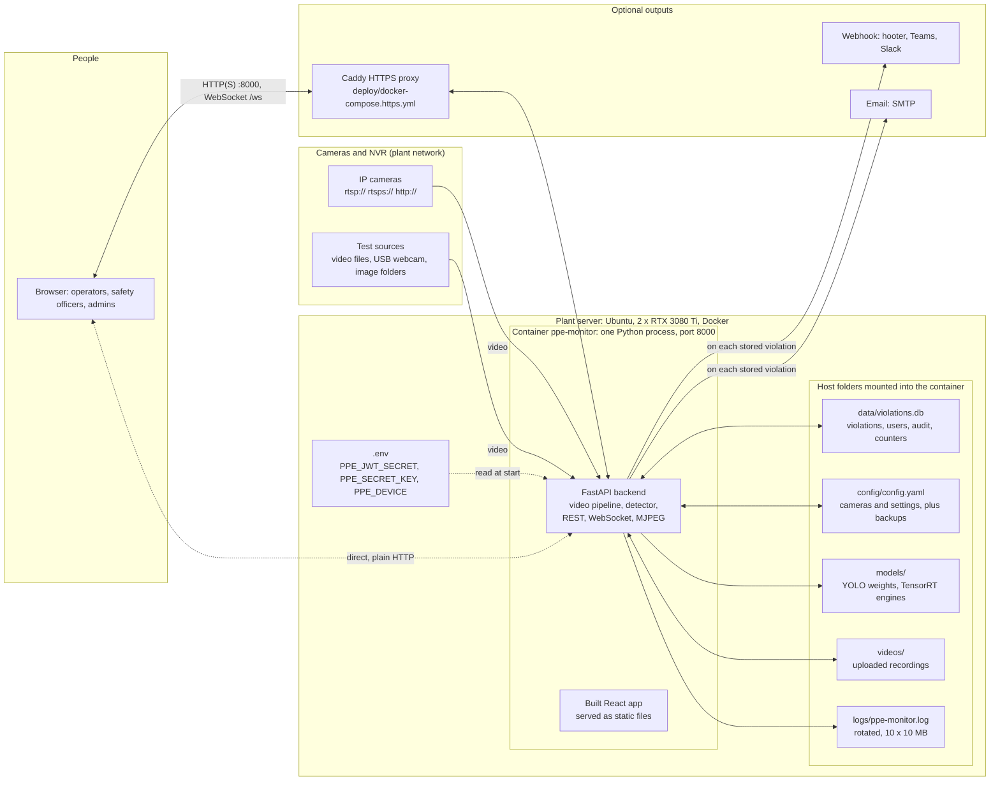
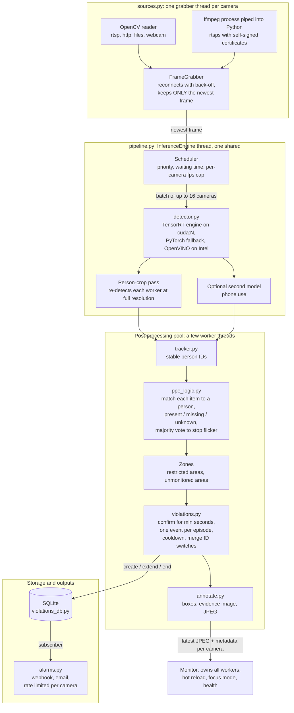
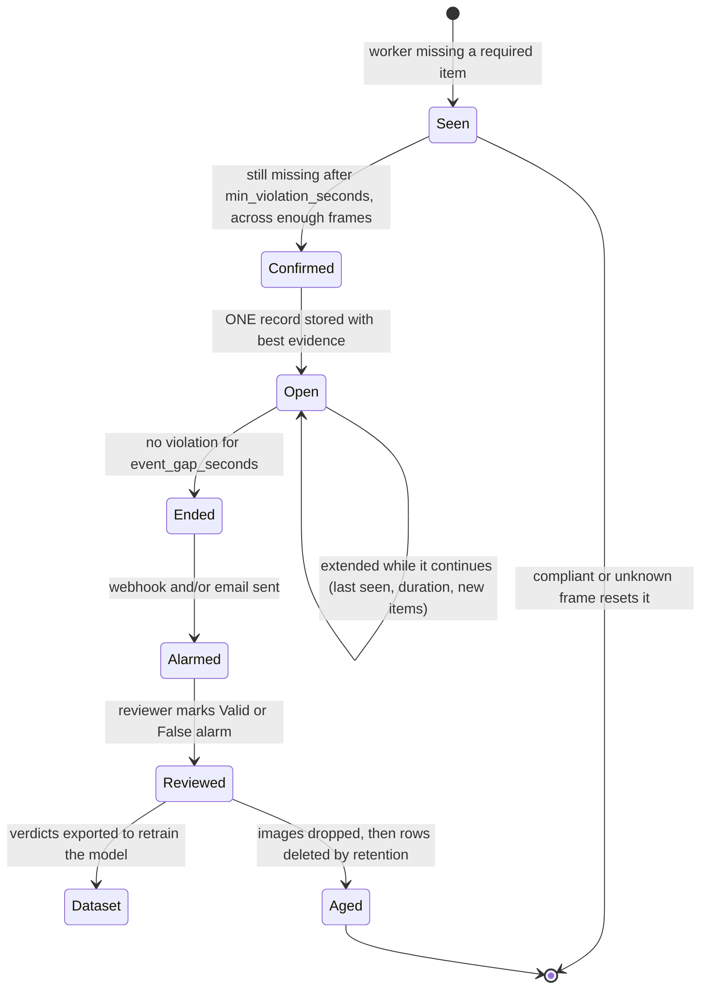
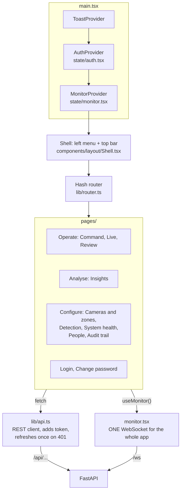
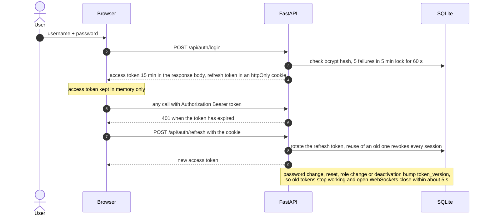
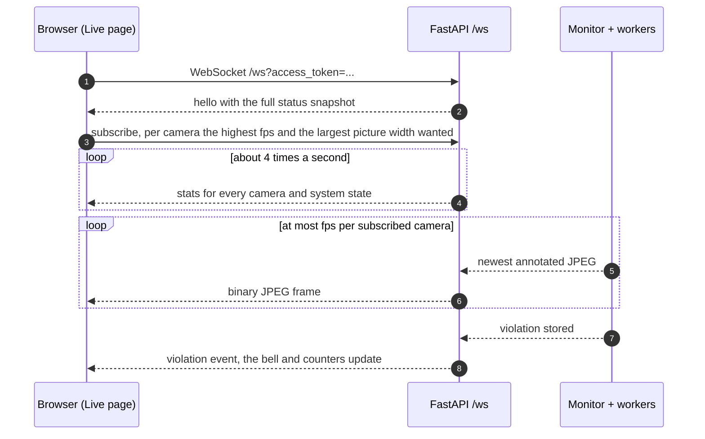
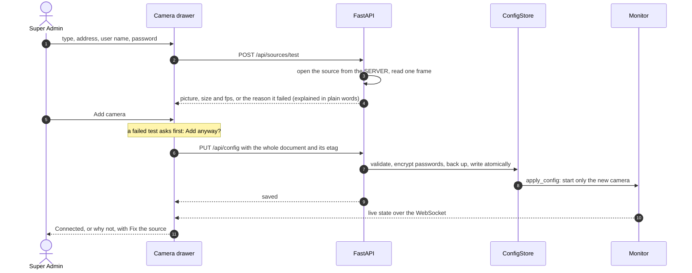
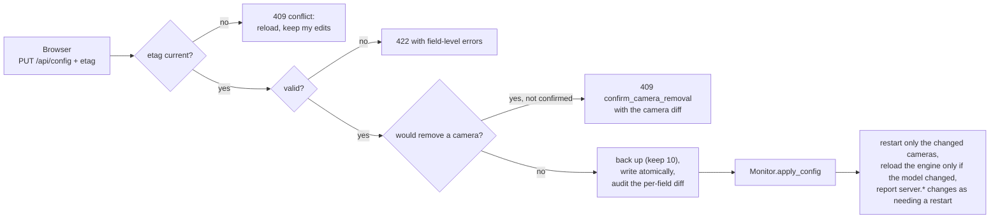
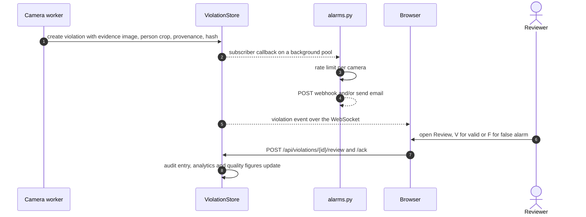

# Architecture: from the camera to the browser

How the PPE Compliance Monitor works end to end, as built today. Diagrams are Mermaid and render on GitHub.
`PROJECT_WALKTHROUGH.md` explains each file in depth for a newcomer; this page is the current map. Where the two
differ, this page is right (the walkthrough's first diagram predates sign-in, Docker/GPU, rtsps and analytics).

**In one paragraph.** One Python process (FastAPI) runs on the plant server inside Docker. It pulls video from the
cameras, runs one shared YOLO detector on the GPU for every camera, works out which worker is missing which PPE,
stores a *violation* with photo evidence in SQLite, and serves a React web app. The browser gets numbers over a
WebSocket, video as JPEG frames, and everything else over a REST API protected by sign-in and roles.

---

## 1. Where everything runs

Everything the system remembers lives in the three mounted folders (`data`, `config`, `logs`), so rebuilding or
recreating the container loses nothing. Secrets stay in `.env` and are never inside the image.

---

## 2. Inside the backend: life of a camera frame

**Why it holds up under load.** Every hand-off keeps only the newest item, and the engine only takes a camera that
has a *new* frame whose previous frame is already processed. A slow, stalled or crashed camera drops out of the
batch without delaying the others, and load can never turn into a growing queue. Thread count is N grabbers + 1
engine + a small pool, not two per camera.

**Detector choice at start-up (`detector.py`).** On a CUDA machine it picks the GPU with the most free memory and
loads the TensorRT engines; if they do not fit in memory it falls back to PyTorch. With no GPU it uses OpenVINO on
an Intel iGPU, then CPU. The inference thread is pointed at the model's GPU before every call.

---

## 3. A violation's life

Violations are *events*, not frames: the same worker standing there is one record that grows, not hundreds. A track
ID switch, a duplicate box or a group box around several workers joins the same event. The Review page is where
people mark each one **Valid** or **False alarm**; those verdicts feed the quality figures in Insights and the
dataset export (`GET /api/violations/dataset`) used for retraining in `training/`.

---

## 4. The API: what the browser can call

All routes except `/api/health`, `/api/auth/login` and `/api/auth/refresh` require a valid token. Two roles exist,
**Admin** and **Super Admin**; every route checks a named permission, and the UI hides what the role cannot use
(hiding is cosmetic, the server is the gate).

| Group | Routes | Used by |
|---|---|---|
| Sign-in | `POST /api/auth/login` · `/refresh` · `/logout` · `/change-password` · `GET /api/auth/me` | Login page, every request |
| Live state | `GET /api/status` · `/api/streams` · `/api/streams/{id}` · `POST /start` `/stop` · `PATCH /settings` · `POST /api/focus` | Live, Command, camera drawer |
| Live video | `GET /api/streams/{id}/mjpeg` · `/frame.jpg` · WebSocket `/ws` (binary JPEG per subscribed camera) | Live wall, tiles, zone editor |
| Violations | `GET /api/violations` (+ filters, `/{id}`, `/stats`) · `POST /{id}/ack` `/review` · `DELETE /{id}` · `GET /export` `/dataset` | Review, exports |
| Analytics | `GET /api/analytics/summary` · `/timeseries` · `/by-camera` · `/by-ppe-type` · `/heatmap` · `/top-offenders` · `/review-quality` | Command, Insights |
| Cameras and settings | `GET/PUT /api/config` · `/schema` · `/validate` · `/reset` · `/backups` · `/restore` | Cameras and zones, Detection |
| Add camera | `POST /api/sources/test` · `GET /api/sources/files` · `POST /api/sources/upload` | Add camera form |
| People and audit | `GET/POST/PATCH/DELETE /api/users` · `POST /{id}/reset-password` · `GET /api/audit` | People, Audit trail |
| System | `GET /api/health` (liveness only) · `GET /api/system/health` (per-camera, detector load, host) | Docker health check, System health |

Anything else under `/api` answers 404. Any other path serves the React app (`index.html`), which is how the
browser routes work.

---

## 5. Inside the frontend

- **One WebSocket for the whole app.** It carries camera statistics about four times a second, violation events
  as they happen, and binary JPEG frames for exactly the cameras a page has asked to see (`subscribe`: per camera, the highest rate and the largest picture any viewer needs). Pages read
  it through `useMonitor()`, so they never open their own connections.
- **REST for everything else.** `lib/api.ts` keeps the access token in memory only, refreshes it once from a
  `httpOnly` cookie when a call returns 401, and signs the user out when the refresh fails.
- **Permissions in the UI.** `useAuth().can("config:system")` shows or hides buttons. The server still refuses a
  forbidden call.
- **Settings pages edit one document.** Cameras and Detection read the whole config with its `etag`, change part of
  it, and save the whole thing back. A stale `etag` gives a conflict instead of overwriting someone else's edit.
- **Build.** `npm run build` makes `frontend/dist`, which the Docker image copies in. FastAPI serves it with a
  content-security header that allows only the build's own inline script.

---

## 6. End-to-end flows

### 6.1 Sign in and stay signed in

A new install seeds one Super Admin from `PPE_INITIAL_ADMIN_PASSWORD`, or a random one-time password printed in the
log, and forces a change at first sign-in. `python -m app.reset_password` on the server recovers a lost password
without deleting users or data.

### 6.2 Watching live

Tokens go in the query string only because browsers cannot send headers on a WebSocket or ``; log lines mask
them.

### 6.3 Adding a camera

Camera passwords are encrypted in `config.yaml` (`enc:...`) with `PPE_SECRET_KEY` and never returned by the API (the
UI sees `********`). The key must never change, or every saved password becomes unreadable.

### 6.4 Saving settings and hot reload

Cameras are protected: a reset, restore or save that would remove one is refused until the named cameras are
confirmed.

### 6.5 From violation to alarm to review

---

## 7. Data and secrets

| What | Where | Notes |
|---|---|---|
| `violations` | `data/violations.db` | one row per event, evidence images stored as blobs |
| `observations` | same file | per-camera counters that drive compliance rates and heatmaps |
| `users`, `refresh_tokens`, `audit_log` | same file | audit never stores passwords |
| Cameras and settings | `config/config.yaml` | `config.backup.<time>.yaml` kept, last 10 |
| Camera passwords | inside `config.yaml` as `enc:...` | key `PPE_SECRET_KEY` |
| Sign-in signing key | `.env` `PPE_JWT_SECRET` | changing it signs everyone out |
| Application log | `logs/ppe-monitor.log` | also holds the one-time admin password line |
| Models | `models/` | weights plus engines built for this GPU |

SQLite in WAL mode with one writer is deliberate: it needs no extra service on a single plant server. The limit is
one machine and up to 64 cameras per config. Retention settings delete old images first, then old rows.

---

## 8. Security at a glance

- Every `/api` route needs a token, tested in `test_auth.py` ("every route rejects anonymous calls"). The
  WebSocket and `` MJPEG streams take a query token checked when the connection opens.
- Passwords are bcrypt-hashed, with a policy (8+ characters, letter and digit, not the username).
- Access tokens last 15 minutes; refresh tokens rotate and reuse is treated as theft.
- Responses carry strict security headers; the page's only inline script is allowed by its hash.
- Camera credentials are encrypted at rest and a stored password is only reused for the same camera endpoint.
- Admins cannot read `${PPE_JWT_SECRET}` through camera fields: only `${PPE_VIDEOS_DIR}` expands there.
- Run HTTPS in front on any shared network (`deploy/docker-compose.https.yml`). Direct port 8000 is plain HTTP.

Details: `SECURITY.md`.

---

## 9. Operating it

| Need | Command or place |
|---|---|
| Start, stop, update | `sudo docker compose up -d --build` · `stop` · `git pull` first |
| Is it healthy? | Setup, System health in the app; `GET /api/system/health`; `/api/health` only proves the web server answers |
| Logs | `logs/ppe-monitor.log` or `sudo docker compose logs ppe-monitor` |
| Lost admin password | `sudo docker compose exec ppe-monitor python -m app.reset_password --generate` |
| Cameras offline with "can't be decrypted" | restore the old `PPE_SECRET_KEY` in `.env`, then `up -d` |
| Pick the GPU | `PPE_DEVICE=auto` (most free memory), `cuda:0`, `cuda:1` in `.env` |
| Back up | copy `data/`, `config/` and `.env` (the key and the database go together) |

---

## 10. Where to change what

| Change | Files |
|---|---|
| A new kind of camera source | `backend/app/sources.py` (register in `SOURCE_TYPES`), then `SourceForm.tsx` |
| What counts as a violation | `ppe_logic.py`, `violations.py`, `alerts.*` in `config.default.yaml` |
| A new model or PPE class | `models/`, `model.class_map` in the config, `detector.py` |
| A new screen | `frontend/src/pages/`, the menu in `Shell.tsx`, a route in `api.py` with a permission |
| A new permission | `security.py` `PERMISSIONS` and `ROLE_PERMISSIONS`, then `can()` in the UI |
| Alert delivery | `alarms.py` and the `alarm:` section of the config |
